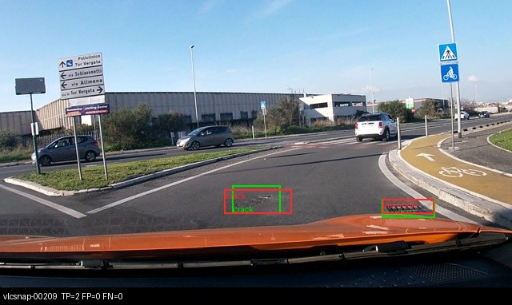
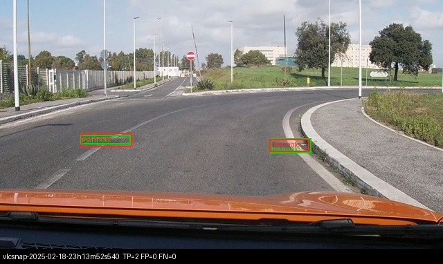
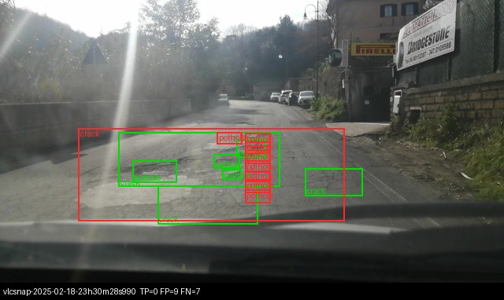
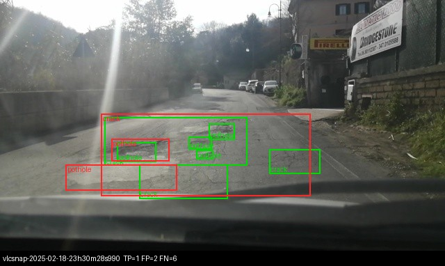
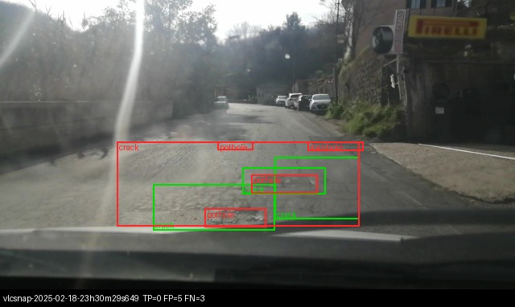
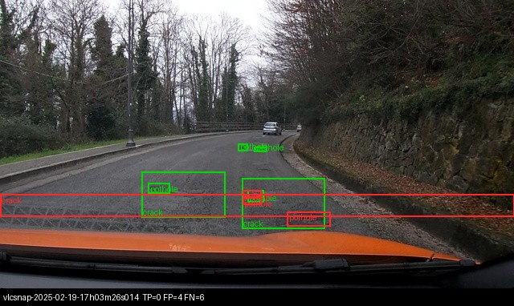
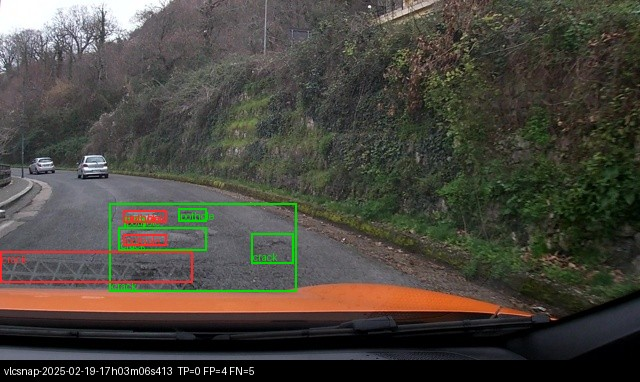

Họ tên: Nguyễn Văn Quốc Việt
`dataset_version`: d10-21e4070301

Môi trường: Google Colab, **Tesla T4 16 GB**; transformers 5.19.0, peft 0.21.2, bitsandbytes 0.50.2. Mã: gói `lab/` + `lab_day10.ipynb`.

## Bảng tổng hợp (số của bạn, lấy từ `report/evidence/*.json`)

Bảng sinh tự động bằng `python -m lab.summarize --write` (đọc thẳng các file bằng chứng). VRAM/phút lấy từ `meta` (= `run.json` của lần train).

<!-- TABLE:START -->
| Mã | Setup | Tham số huấn luyện | VRAM đỉnh (GB) | Phút | F1 | CI95 | FP/ảnh | F1 pothole | F1 crack | F1 manhole | parse_valid |
|---|---|---|---|---|---|---|---|---|---|---|---|
| E0 | zero-shot | 0 | — | — | 0.095 | [0.066, 0.127] | 0.91 | 0.129 | 0.032 | 0.200 | 0.929 |
| E1 | LoRA LLM | 33,030,144 | 6.32 | 47.6 | 0.283 | [0.246, 0.324] | 1.10 | 0.194 | 0.197 | 0.539 | 0.997 |
| E2 | + projector | 142,135,296 | 7.93 | 49.6 | 0.359 | [0.319, 0.400] | 0.95 | 0.222 | 0.281 | 0.596 | 1.000 |
| E3 | + LoRA ViT | <điền E3> | | | | | | | | | |
| E4 data_size=0.1 | data_size = 0.1 | 142,135,296 | 7.59 | 48.9 | 0.172 | [0.144, 0.202] | 2.15 | 0.087 | 0.124 | 0.409 | 1.000 |
| E4 data_size=1.0 | data_size = 1.0 | 142,135,296 | 7.93 | 49.6 | 0.359 | [0.319, 0.400] | 0.95 | 0.222 | 0.281 | 0.596 | 1.000 |
<!-- TABLE:END -->

`E4 data_size=1.0` chính là E2 (cùng file dự đoán), chấm lại dưới tên E4 để có đủ hai giá trị của biến.

## 10 câu hỏi (trả lời bằng **số của bạn**, không chép lại tài liệu)

### Câu 1 — Kiến trúc: ViT, projector và LLM của Qwen3-VL-4B có bao nhiêu tham số mỗi khối, và E1/E2/E3 mỗi cái cập nhật khối nào?
Đếm bằng `describe_architecture()` (dựng model trên meta device, không tải trọng số):

| Khối | Tham số |
|---|---|
| ViT (patch embed + 24 block) | 306,2 M |
| `visual.merger` | 27,3 M |
| `visual.deepstack_merger_list` (3 merger cho đặc trưng lớp 5, 11, 17) | 81,8 M |
| → toàn bộ phần thị giác | 415,3 M |
| LLM (`language_model`: 36 lớp + embedding 151.936 × 2560) | 4.022,5 M |
| Tổng (lm_head **dùng chung** trọng số với embedding) | ≈ 4.437,8 M ≈ 4,44 B |

Lưu ý: bộ đếm in thêm `lm_head 389,0 M` và tổng 4.826,8 M vì model dựng trên meta device chưa buộc (tie) `lm_head` với embedding; `tie_word_embeddings=True` nên tổng thật phải trừ 389 M.

- **E1**: LoRA r=16 trên 252 module của LLM (q/k/v/o + gate/up/down × 36 lớp) = **33.030.144** tham số. ViT và projector đóng băng.
- **E2**: E1 + mở đầy đủ `visual.merger` và `visual.deepstack_merger_list` (fp32) = **142.135.296** tham số, hơn E1 đúng **109.105.152** (= 27,3 M + 81,8 M).
- **E3**: E2 + LoRA trên 96 module của ViT (qkv/proj + linear_fc1/fc2 × 24 block), tổng 348 module = <điền E3: số tham số> tham số.

(Số "tổng" 2.654.188.032 in trong log train nhỏ hơn 4,44 B vì trọng số NF4 được đóng gói 2 giá trị/byte nên `numel()` chỉ bằng một nửa.)

### Câu 2 — E0: `parse_valid_rate` bằng bao nhiêu, và hai lỗi phổ biến nhất của model gốc là gì (kèm một ví dụ output thô)?
`parse_valid_rate` của E0 = **0,929** (22/311 output không parse được). Model gốc không bọc ```` ```json ````, không bịa lớp ngoài 3 lớp, không trả toạ độ > 1000: nó **hiểu đúng định dạng và thang 0–1000**. Ví dụ output thô (ảnh `vlcsnap-00200`):
```
[{"label": "manhole", "bbox_2d": [759, 640, 843, 687]}]
```
Hai lỗi phổ biến nhất:
1. **Định vị sai / box bịa (FP)**: 326 box dự đoán nhưng precision chỉ 0,132; với crack, model đoán 205 box mà F1 crack chỉ 0,032. Thường gặp là một box "crack" rất dẹt kéo ngang cả khung hình hoặc nằm trên nắp capo xe (ảnh `report/figures/e0_sai_1.jpg`, `e0_sai_2.jpg`: TP=0, FP=4). Model gốc không biết quy ước ghi nhãn của bộ dữ liệu này (crack được khoanh theo từng vùng).
2. **Bỏ sót (FN)**: recall 0,074; trung bình model chỉ đưa 1,05 box/ảnh trong khi test có 583/311 = 1,87 box/ảnh, và 8 ảnh trả `[]`. Ổ gà nhỏ gần như bị bỏ qua (F1 pothole 0,129).
Ngoài ra còn 7,1 % output không parse được, khiến cả ảnh bị tính như không dự đoán.

### Câu 3 — Thang 0–1000: nếu chấm output theo pixel (hoặc ngược lại) thì F1 ra sao và vì sao? Bạn đã kiểm chứng điều này thế nào?
`score.py --coord pixel` coi toạ độ là pixel và đổi sang 0–1000 bằng cách nhân x với 1000/640 ≈ 1,56 và y với 1000/360 ≈ 2,78. Nếu model trả thang 0–1000 mà ta chấm như pixel, mọi box bị kéo giãn và đẩy xuống dưới/sang phải, nhiều box vượt khỏi khung 1000, nên IoU với box đúng gần như luôn < 0,5. JSON vẫn hợp lệ nên đây là lỗi "âm thầm".

Kiểm chứng: chấm lại **đúng file dự đoán của E1** với `--coord pixel` → F1 = **0,000** (P = R = 0, meanIoU = 0), trong khi `parse_valid_rate` vẫn 0,997 và F1 khi chấm đúng thang là **0,283**. FP/ảnh tăng từ 1,10 lên 1,59 vì mọi box đều thành FP. Chiều ngược lại được kiểm tra khi dựng nhãn: quy box JSON 0–1000 ngược về pixel và vẽ lại trùng box YOLO gốc; sai số lớn nhất trên toàn train là 5,00 px — lớn hơn sai số làm tròn (≤ 0,64 px theo x) do một số box YOLO tràn khỏi mép ảnh và bị kẹp về [0, 1000].

### Câu 4 — Mask loss: vì sao chỉ tính loss trên phần trả lời? Điều gì xảy ra nếu tính trên cả prompt và token ảnh?
Một ví dụ huấn luyện (ảnh 9 box) dài **588 token**, trong đó **220 token ảnh** và chỉ **250 token đáp án** (JSON + `<|im_end|>\n`); 338 token còn lại (57 %) là chat template, prompt và ảnh. Mình kiểm tra bằng cách giải mã riêng các token có `labels != -100`: ra đúng chuỗi JSON đáp án + `<|im_end|>`.

Prompt và token ảnh là **đầu vào** model luôn được cho sẵn lúc suy luận; mục tiêu cần học là p(đáp án | ảnh, prompt). Nếu tính loss trên cả chuỗi: (1) hơn một nửa gradient dùng để đoán lại prompt cố định (giống hệt nhau ở mọi ví dụ, loss về ~0 rất nhanh) và các `<|image_pad|>` vốn chỉ là placeholder, nên tín hiệu từ toạ độ bị pha loãng; ảnh ít box thì đáp án chỉ vài chục token, tỉ lệ còn tệ hơn; (2) model có thể học "nói lại" template/prompt thay vì trả JSON; (3) loss trung bình giảm nhanh nhưng không phản ánh chất lượng định vị nên khó dùng để gỡ lỗi.

### Câu 5 — Vì sao không thể huấn luyện đầy đủ projector nếu ViT bị lượng tử hoá 4-bit, và bạn đã xử lý thế nào? Vì sao projector phải ở float32?
Lớp NF4 lưu trọng số dạng `Params4bit`: số nguyên 4-bit đóng gói (2 giá trị/byte) + hằng số scale. Đó không phải tensor số thực khả vi: không có `.grad` có nghĩa, optimizer không thể cộng một bước cập nhật nhỏ vào mã 4-bit. Trên lớp 4-bit chỉ huấn luyện được adapter (LoRA) gắn thêm.

Mình gặp đúng lỗi này: với transformers 5.19, `llm_int8_skip_modules=["visual", "lm_head"]` **không có tác dụng** — lần chạy thử đầu tiên in `projector 54.579.200`, đúng một nửa 109 M, tức merger đã bị đóng gói 4-bit. Cách xử lý: ghi thêm tên đầy đủ `"model.visual"` vào danh sách bỏ qua, và sau khi nạp thì kiểm tra không còn `Linear4bit` nào trong `visual` (nếu còn thì giải lượng tử về fp16). Sau khi sửa, log in `projector 109.105.152`.

Cần fp32 vì: (a) fp16 chỉ có ~3 chữ số thập phân, bước cập nhật cỡ lr·Adam ≈ 2e-4 cộng vào trọng số cỡ 1e-2 thường bị làm tròn mất; (b) `GradScaler.unscale_` từ chối gradient fp16 — lần chạy đầu của mình báo đúng lỗi `Attempting to unscale FP16 gradients` vì LoRA được tạo ở fp16, phải đưa mọi tham số huấn luyện lên fp32. Cái giá: VRAM đỉnh tăng từ 6,32 GB (E1) lên 7,93 GB (E2), +1,61 GB — khớp ước lượng 109 M × 4 byte × 4 (trọng số fp32, gradient, hai moment của AdamW) ≈ 1,75 GB.

### Câu 6 — Split theo phiên quay: vì sao chia ngẫu nhiên sẽ cho F1 cao giả? Số ảnh và số box từng lớp ở mỗi split là bao nhiêu?
Ảnh là frame cắt từ video, frame liền kề gần như trùng nhau (cùng ổ gà, cùng góc nhìn). Chia ngẫu nhiên thì gần như mọi ảnh test đều có "anh em sinh đôi" trong train: model chỉ cần nhớ, F1 test đo khả năng nhớ chứ không đo khả năng tổng quát sang đoạn đường mới. Mức độ học thuộc rất mạnh thấy rõ ở E4: với 142 ảnh, loss train về 0,003–0,007 mà F1 test chỉ 0,172 — nếu test chứa frame gần trùng với train, con số này sẽ bị thổi phồng. Chia theo phiên (ngày + giờ trong tên file) buộc test là các đoạn đường chưa từng thấy. Mình đã kiểm tra: không phiên nào xuất hiện ở hai split.

| Split | Ảnh | Phiên | pothole | crack | manhole |
|---|---|---|---|---|---|
| train | 1.422 | 13 | 1.074 | 1.750 | 691 |
| val | 276 | 2 | 66 | 470 | 103 |
| test | 311 | 3 | 121 | 299 | 163 |

Phân bố lớp lệch giữa các split (val chỉ 66 pothole), vì cả phiên đi cùng nhau.

### Câu 7 — So sánh E1/E2/E3: mở projector và LoRA trên ViT có đáng không (F1, CI95, VRAM, thời gian)?
- **E1 → E2 (mở projector)**: F1 0,283 → **0,359** (+0,076), cả ba lớp đều tăng (crack +0,084, manhole +0,057, pothole +0,028), FP/ảnh giảm 1,10 → 0,95. Chi phí: +109 M tham số, VRAM 6,32 → 7,93 GB, thời gian 47,6 → 49,6 phút (+4 %). CI95 [0,246; 0,324] và [0,319; 0,400] gần như không chồng nhau (chỉ chạm ở 0,319–0,324), nên đây là cải thiện khá chắc chắn với chi phí rất nhỏ → **đáng**. Diễn giải: projector là chỗ ánh xạ đặc trưng ảnh sang không gian LLM; cho nó học giúp đặc trưng mặt đường (vốn hiếm trong dữ liệu tiền huấn luyện) được biểu diễn rõ hơn, trong khi LoRA LLM chỉ học cách "đọc" đặc trưng có sẵn.
- **E2 → E3 (LoRA ViT)**: <điền E3: F1, CI95, VRAM, phút; chênh với E2 có vượt CI95 không; có đáng chi phí VRAM/thời gian không>.

Kết luận: <điền E3: setup đáng đồng tiền nhất>.

### Câu 8 — Tập test có 311 ảnh: khoảng tin cậy rộng thế nào, và điều đó giới hạn kết luận so sánh các setup ra sao?
CI95 là bootstrap theo ảnh (lấy mẫu lại 311 ảnh, 1000 lần) do `score.py` tính. Độ rộng: E0 0,061; E1 0,078; E2 0,081; E4 (10 %) 0,058; <điền E3: độ rộng> — tức khoảng **±0,04 điểm F1** quanh giá trị đo.

Hệ quả:
- "Fine-tune tốt hơn zero-shot" (0,095 → 0,283/0,359) và "10 % dữ liệu kém hơn 100 %" (0,172 vs 0,359) là kết luận vững: CI cách xa nhau.
- E1 vs E2 chênh 0,076 ≈ độ rộng một CI; hai CI chỉ chạm nhau nên kết luận E2 > E1 khá đáng tin nhưng chưa tuyệt đối. Vì cả hai được chấm trên **cùng 311 ảnh**, so sánh đúng hơn là bootstrap **ghép cặp** (lấy mẫu cùng tập ảnh cho cả hai setup rồi xét phân bố của hiệu); CI của từng setup riêng lẻ là phép thử bảo thủ.
- Với chênh lệch < ~0,04 (<điền E3: E2 vs E3>), không thể kết luận setup nào tốt hơn.
- CI bootstrap theo ảnh còn **lạc quan**: test chỉ có 3 phiên quay, ảnh trong cùng phiên tương quan mạnh nên số mẫu độc lập thực sự ít hơn 311 nhiều; đổi sang 3 phiên khác, F1 có thể dịch hơn ±0,04.

### Câu 9 — Phân tích lỗi theo lớp: lớp nào kém nhất và vì sao (kích thước box, số mẫu, ngữ nghĩa)? Kèm ảnh minh hoạ.
Với setup tốt nhất E2: F1 pothole **0,222** (P 0,286 / R 0,182), crack **0,281**, manhole **0,596**. Recall theo diện tích box (tỉ lệ khung hình) trên test:

| Lớp | Diện tích trung vị | Nhỏ < 0,5 % | Vừa 0,5–2 % | Lớn ≥ 2 % | Box train |
|---|---|---|---|---|---|
| pothole | 0,42 % | 10/68 (15 %) | 8/46 (17 %) | 4/7 | 1.074 |
| crack | 1,98 % | 1/15 (7 %) | 27/136 (20 %) | 52/148 (35 %) | 1.750 |
| manhole | 0,67 % | 25/64 (39 %) | 64/96 (67 %) | 1/3 | 691 |

- **Pothole kém nhất** dù có 1.074 box train (nhiều hơn manhole): box nhỏ nhất (trung vị 0,42 % khung hình, 68/121 box < 0,5 %), mà ảnh 640×360 chỉ có 220 token, mỗi token ứng với một ô 32×32 px — một ổ gà nhỏ chỉ chiếm 1–2 token. Ngữ nghĩa cũng mơ hồ: ổ gà thường nằm lẫn trong vùng nứt, model hay gán nhầm thành crack hoặc ngược lại (`e2_sai_2.jpg`, `e2_sai_3.jpg`).
- **Crack**: box lớn (trung vị 1,98 %) nhưng ranh giới vùng nứt do người gán nhãn tự khoanh, không có biên rõ; model khoanh một vùng rộng hơn/hẹp hơn là IoU < 0,5 (`e2_sai_1.jpg`: TP=0, FP=4, FN=4 dù vị trí gần đúng). Crack nhỏ gần như không bắt được (1/15).
- **Manhole tốt nhất**: hình dạng chữ nhật/tròn rõ, tương phản cao, kích thước ổn định → recall 67 % ở cỡ vừa, kể cả ở xa (`e2_dung_2.jpg`, `e2_dung_3.jpg`).

Ảnh minh hoạ (xanh = box đúng, đỏ = box dự đoán; chú thích dưới ảnh ghi TP/FP/FN):

| | |
|---|---|
|  E2 đúng: crack + manhole (TP=2) |  E2 đúng: 2 manhole (TP=2) |
|  E2 đúng: manhole ở xa (TP=2) |  E2 sai: vùng crack lệch IoU (FP=4, FN=4) |
|  E2 sai: một box lớn trùm cả vùng hư hại (FP=2, FN=6) |  E2 sai: nhầm pothole/crack (FP=5, FN=3) |
|  E0 sai: box crack dẹt kéo ngang cả ảnh |  E0 sai: box "crack" nằm trên capo xe |

### Câu 10 — E4: bạn đổi biến nào, kết quả thế nào, và kết luận có đáng tin không?
Biến: **`data_size`**, chỉ đổi `train_fraction` của setup E2 (chọn E2 vì là setup tốt nhất <điền E3: xác nhận sau khi có E3>): 10 % (142 ảnh) và 100 % (1.422 ảnh). Mọi thứ khác giữ nguyên: r=16, lr 2e-4, 300 bước × 8 ảnh, seed 42.

| | F1 | CI95 | P | R | FP/ảnh | loss train cuối |
|---|---|---|---|---|---|---|
| 10 % | 0,172 | [0,144; 0,202] | 0,150 | 0,202 | 2,15 | 0,003–0,007 |
| 100 % | 0,359 | [0,319; 0,400] | 0,394 | 0,329 | 0,95 | ≈ 0,5 |

Với 10 %, 300 bước × 8 ảnh = 2.400 lượt ≈ 17 epoch trên 142 ảnh: loss train về gần 0 (học thuộc), nhưng F1 test chỉ còn một nửa và FP/ảnh tăng gấp đôi — model "nhớ" bố cục box của ảnh train và vẽ nhiều box bịa. Hai CI95 cách xa nhau (0,202 < 0,319), nên kết luận "dữ liệu nhiều hơn giúp rõ rệt" là **đáng tin** dù test chỉ 311 ảnh. Hạn chế: chỉ có hai điểm (10 %, 100 %) và một seed, nên không nói được đường cong theo kích thước dữ liệu bão hoà ở đâu.

## Nhìn lại

- **Lỗi công cụ chấm không bắt được**: với transformers 5.19, `llm_int8_skip_modules=["visual"]` bị bỏ qua âm thầm — ViT và projector bị lượng tử hoá 4-bit mà không có cảnh báo nào. Nếu không đối chiếu số tham số projector (54,6 M thay vì 109 M) thì E0 chạy với ViT 4-bit, E2/E3 "huấn luyện" trên trọng số đóng gói và kết quả sai mà `score.py` vẫn chấm bình thường. Bài học: luôn in và đối chiếu số tham số với con số kỳ vọng.
- E3 lần đầu lỗi do môi trường (`torchao` 0.10 có sẵn trên Colab không tương thích peft khi gắn LoRA vào Linear fp16 của ViT); gỡ `torchao` là chạy được.
- Thời gian thật trên T4: ~48–50 phút/300 bước (README ước 20–30 phút), suy luận 311 ảnh ~15 phút.
- Nhãn crack mơ hồ: nhiều ảnh khoanh cả vùng nứt lớn thành một box, ảnh khác khoanh từng vết; với ngưỡng IoU 0,5, F1 crack bị giới hạn bởi độ nhất quán của nhãn hơn là năng lực model.
- Điều chưa chắc: CI bootstrap theo ảnh có quá hẹp không khi test chỉ có 3 phiên; muốn chắc nên bootstrap theo phiên hoặc thêm phiên vào test.
